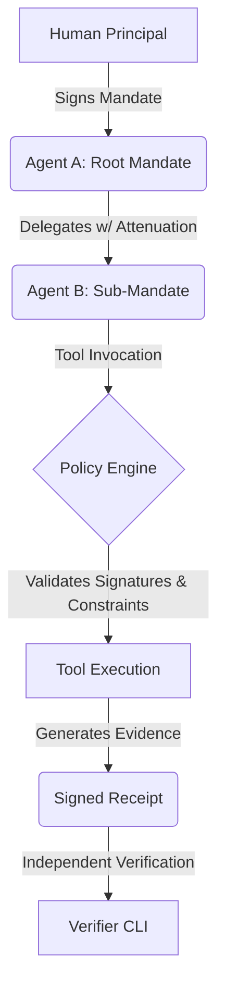

# AUCTOR

[](https://github.com/bleedZzzz/auctor)
[](https://opensource.org/licenses/Apache-2.0)
[](https://www.python.org/downloads/)
[](CONTRIBUTING.md)
[](#security-guarantees)
[](https://github.com/bleedZzzz/auctor/stargazers)

**Autonomous agents. Bounded authority. Verifiable outcomes.**

AUCTOR is an open-source, portable, independently verifiable runtime for governing AI agent authority, combining AI security, policy-as-code, and identity management.

## The Problem
As AI agents gain the ability to invoke tools and access sensitive systems, providing them with unrestricted authority becomes a critical security risk. Traditional solutions often rely on proprietary runtimes, complex TEEs, or centralized black-box APIs. 

AUCTOR provides a **local-first, framework-neutral** layer for governance that is:
- **Proof-Carrying**: Every action produces a cryptographically signed receipt.
- **Portably Verifiable**: Evidence can be checked offline by any party without needing access to the original agent runtime.
- **Attenuating**: Delegation chains ensure that sub-agents cannot expand the authority granted by their parent.

---

## How it Works



1.  **Identity**: Principals (humans or agents) are identified by Ed25519 keypairs.
2.  **Mandates**: Authority is defined via signed JSON-LD-like envelopes specifying permitted tools and resource constraints.
3.  **Execution**: The AUCTOR runtime acts as an enforcement boundary, intercepting tool calls and validating them against the active mandate chain.
4.  **Verification**: Successful actions generate a signed receipt, which can be verified offline to prove that the execution was authorized and untampered.

---

## Getting Started

### Installation
```bash
pip install -e .
```

### Quick Start
```bash
# 1. Initialize identity
auctor init

# 2. Issue mandate (Delegation example: Parent -> Child)
auctor issue --subject agent_parent --tool read_file --tool write_file
auctor issue --subject agent_child --tool read_file --parent-file mandate_m_xxxx.json

# 3. Execute permitted tool & generate evidence
auctor run --mandate-file mandate_m_yyyy.json --tool read_file

# 4. Verify evidence receipt
auctor verify --receipt-file receipt_m_yyyy_read_file.json
```

---

## Project Status (MVP)

AUCTOR is currently an experimental MVP.

- [x] **Identity**: Secure Ed25519 key management.
- [x] **Mandates**: Signed JSON envelopes with attenuation support.
- [x] **Enforcement**: Deterministic validation engine.
- [x] **Evidence**: Signed, hash-chained execution receipts.
- [x] **Verification**: Offline validation CLI.

## Security Guarantees

AUCTOR enforces **cryptographic integrity** and **authorization validity**. It does not automatically guarantee that the agent's code is correct or free of logic bugs. See [docs/THREAT_MODEL.md](docs/THREAT_MODEL.md) for a detailed analysis of trust boundaries.

## Contributing
See [CONTRIBUTING.md](CONTRIBUTING.md) for how to get involved. AUCTOR is licensed under the Apache License 2.0.
